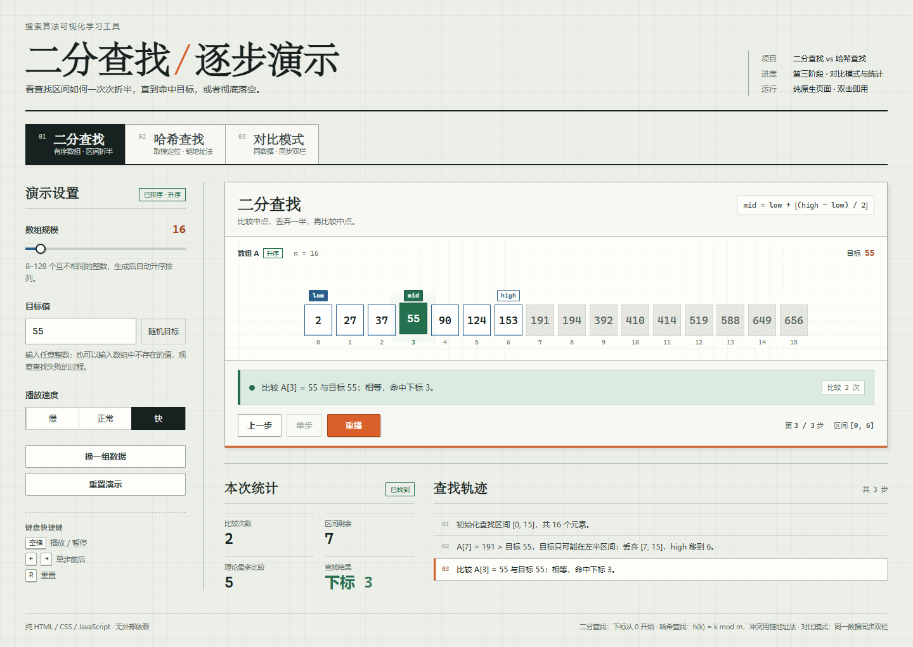
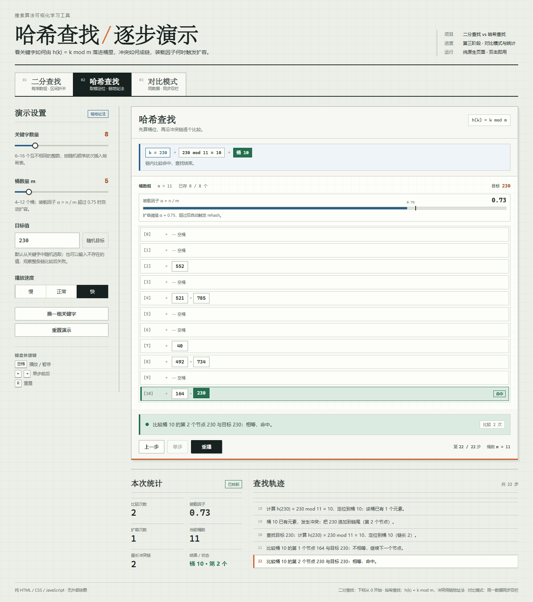
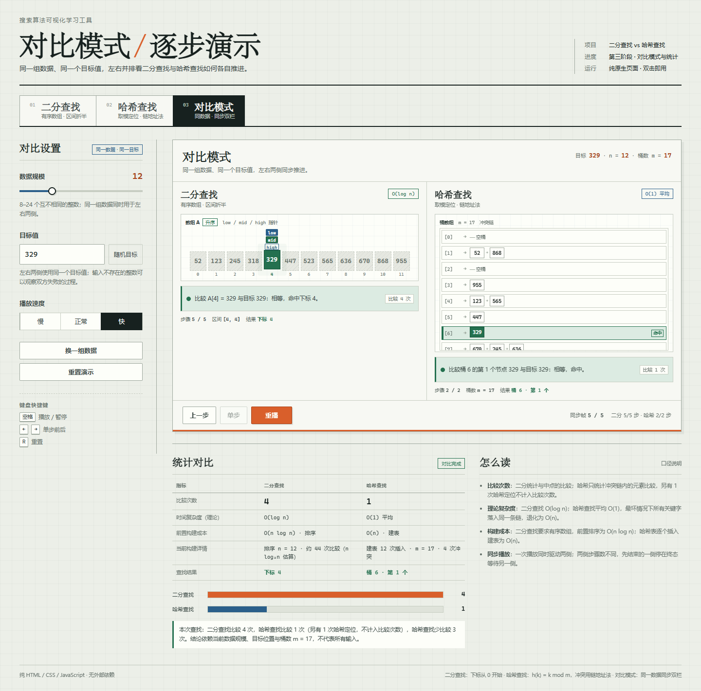

# 二分查找 vs 哈希查找 · 可视化学习工具

计算机导论课程小组大作业。项目用纯原生 HTML / CSS / JavaScript 实现，把**二分查找**与**哈希查找**的执行过程做成可逐步回放的动画，并提供同一组数据下的并排对比视图，帮助初学者把课本里的复杂度结论还原成看得见的查找步骤。

无需安装、无需构建、无外部依赖：双击 `index.html` 即可在浏览器中运行。

## 项目简介

二分查找依赖有序数组，每次比较中点后丢弃一半区间；哈希查找先用哈希函数定位桶，再在冲突链中比较。教材通常直接给出 $O(\log n)$ 与 $O(1)$ 的结论，但初学者很难从静态文字中建立直觉：

- 二分查找每一步到底排除了哪些元素？
- 哈希函数如何把关键字映射到桶？冲突如何形成链表？
- 装载因子、桶数量与冲突链长度会怎样影响查找次数？
- 同一组数据、同一个目标值，两种查找的路径和比较次数差多少？

本项目把上述过程拆成可单步、可回放、可对比的步骤序列，并用统计面板实时显示比较次数、装载因子、扩容次数等指标。

## 三个视图

### 01 · 二分查找

- 生成 8–128 个互不相同的整数，自动升序排列并渲染为方格数组；
- 输入任意目标值，支持命中与未命中两种结束状态；
- 逐步动画展示 `low` / `mid` / `high` 指针移动、当前比较元素、已排除区间与剩余区间；
- 支持上一步、单步、自动播放 / 暂停、重置与慢 / 正常 / 快三档速度；
- 实时统计比较次数、剩余元素数、理论最多比较次数与查找结果；
- 查找轨迹记录每一步的文字说明，可点击跳转回看；
- 支持空格播放 / 暂停、`←` / `→` 单步、`R` 重置等键盘快捷键。

### 02 · 哈希查找

- 生成 6–16 个互不相同的整数，按随机顺序依次插入哈希表；
- 桶数量 `m` 可在 4–12 之间调整，演示 `h(k) = k mod m` 的计算过程；
- 用链地址法处理冲突：先定位桶，再挂链；查找时沿冲突链逐节点比较；
- 实时显示装载因子 `α = n / m`，超过 `0.75` 时演示扩容提示与 rehash 重新分布；
- 统计比较次数、装载因子、扩容次数、当前桶数、最长冲突链与查找结果；
- 与二分查找一致的播放、单步、重置、调速与轨迹跳转交互。

### 03 · 对比模式

- 同一组数据、同一个目标值，左右双栏并排展示二分查找与哈希查找；
- 一次播放或单步同时驱动左右两侧，两侧步骤数不同时先结束的一侧停在终态等待；
- 统计对比面板列出两侧比较次数、理论时间复杂度（$O(\log n)$ vs $O(1)$ 平均）与前置构建成本（排序 $O(n \log n)$ vs 建表 $O(n)$）；
- 柱状图按比较次数实时增长，结束后给出本次查找的对比结论，并说明结论依赖当前数据、目标位置与桶数。

## 运行截图

以下截图均为在 1440×1000 视口下，通过 Playwright 驱动本机 Edge 打开 `file://` 页面后实际截取（桌面浅色主题，全页截图）。为展示完整交互结果，截图前已将各视图播放到结束状态。

### 二分查找：命中目标



### 哈希查找：冲突链内命中



### 对比模式：同步播放完成



## 快速开始

### 环境要求

- 任意现代桌面浏览器（Chrome、Edge、Firefox、Safari 等）；
- 不需要 Node.js、不需要安装依赖、不需要构建步骤。

### 方式一：双击打开（推荐）

1. 下载或克隆本仓库；
2. 在文件管理器中双击仓库根目录的 `index.html`；
3. 页面直接在浏览器中打开，默认进入「二分查找」视图。

> 项目全部资源使用相对路径，且不发起任何网络请求，因此通过 `file://` 直接打开即可完整运行。

### 方式二：本地静态服务器（可选）

如果浏览器对本地文件有限制，或希望用局域网地址演示，可在仓库根目录启动一个静态服务器：

```bash
# Python 3
python -m http.server 8000

# 或 Node.js（npx 会临时下载 serve，仅用于本地预览）
npx serve .
```

然后访问 <http://localhost:8000>。

### 运行算法测试

仓库内包含三个零依赖的 Node.js 断言脚本，分别覆盖二分查找、哈希表与对比模型：

```bash
node tests/binary-search.test.js
node tests/hash-table.test.js
node tests/compare-model.test.js
```

测试脚本与页面源码相互独立，浏览器运行页面时不会加载它们。

## 项目结构

```text
search-algo-visualizer/
├── index.html                  # 单页入口：标题栏、三个视图标签页与全部面板
├── css/
│   └── style.css               # 全站样式、布局、动效与响应式规则
├── js/
│   ├── binary-search.js        # 二分查找步骤生成（纯逻辑）
│   ├── hash-table.js           # 哈希函数、链地址法、装载因子与 rehash（纯逻辑）
│   ├── compare-model.js        # 对比模式的数据集、两侧步骤与同步帧映射
│   ├── renderer.js             # 二分查找视图渲染
│   ├── hash-renderer.js        # 哈希查找视图渲染
│   ├── compare-renderer.js     # 对比模式双栏与统计图表渲染
│   ├── controls.js             # 通用播放控制器
│   ├── stats.js                # 二分查找统计面板
│   ├── views.js                # 三个视图的标签页切换
│   ├── main.js                 # 二分查找视图入口
│   ├── hash-main.js            # 哈希查找视图入口
│   └── compare-main.js         # 对比模式入口
├── tests/                      # Node.js 算法断言脚本
├── docs/
│   ├── screenshots/            # README 运行截图
│   └── verification/           # 各阶段 PR 的验证截图
├── Project_Requirements_and_Design.md
├── AI_Prompts_Log.md           # AI 结对编程记录
├── LICENSE                     # MIT 许可证
└── README.md
```

## AI 结对编程

项目在需求文档、二分模块、哈希模块与对比模块四个阶段使用了 AI 辅助开发。每组记录都保留了任务目标、提示词原文、AI 产出摘要与人工审查修正过程，详见 [AI_Prompts_Log.md](AI_Prompts_Log.md)。

## 团队成员与分工

> 下表姓名、学号为占位，**待小组成员补充真实姓名与学号**；分工按实际开发阶段记录，可在此基础上微调。

| 成员 | 姓名 / 学号 | 主要分工 |
| --- | --- | --- |
| 成员 A | 待补充 | 项目统筹、需求与设计文档、最终交付检查 |
| 成员 B | 待补充 | 二分查找模块与页面骨架、二分查找测试 |
| 成员 C | 待补充 | 哈希查找模块、链地址法与 rehash 演示、哈希测试 |
| 成员 D | 待补充 | 对比模式、统计面板、截图与兼容性验证 |

## Git 协作记录

项目采用「`main` 保持可运行 + 特性分支开发 + Pull Request 审查合并」的工作流。每个阶段都在独立分支完成，先自测并补齐验证证据，再通过 PR 合并回 `main`；`main` 上只保留经过审查的提交。

### 主要分支与已合并 PR

| PR | 内容 | 特性分支 | 状态 |
| --- | --- | --- | --- |
| [#2](https://github.com/Mikasa91126/search-algo-visualizer/pull/2) | docs: 新增项目需求与设计文档 | `agent/project-design-doc-3c9f9af2ef8f` | 已合并 |
| [#4](https://github.com/Mikasa91126/search-algo-visualizer/pull/4) | feat(ui): 二分查找可视化页面与逐步动画 | `agent/binary-search-ui-skeleton-89b3f1c4354f` | 已合并 |
| [#6](https://github.com/Mikasa91126/search-algo-visualizer/pull/6) | feat(ui): 哈希表可视化模块（哈希函数 + 链地址法） | `agent/hash-table-visualizer-d9c2a2c2450e` | 已合并 |
| [#8](https://github.com/Mikasa91126/search-algo-visualizer/pull/8) | feat(ui): 并排对比模式与性能统计面板 | `agent/compare-mode-stats-2d37bed74e87` | 已合并 |
| 本次收尾 PR | docs: 完善 README、MIT LICENSE 与 AI 结对编程记录 | `agent/readme-license-logs-3b8def32e025` | 审查合并中 |

### 协作流程

1. **从最新 `main` 新建特性分支**：一个分支只做一件事（文档、二分、哈希或对比），避免把无关改动混在同一个 PR 中。
2. **本地开发与自测**：先运行对应的 Node.js 测试脚本，再用浏览器验证交互、键盘操作、窄屏布局与控制台错误。
3. **提交 PR 并写清验证方式**：PR 描述包含改动范围、手动验证步骤、Before / After 截图（界面改动必须提供），以及与既有模块的兼容性结果。
4. **人工审查**：逐条对照 Issue 要求检查实现范围，确认没有破坏已合并模块；对截图证据、随机数据一致性、面板切换后的布局等细节提出修正。
5. **修正后合并**：修正提交推送到同一特性分支，审查通过后由仓库维护者在 GitHub 上合并回 `main`，再进入下一阶段。

例如 PR #4 / #6 / #8 的 Before / After 截图都保存在 `docs/verification/`，其中 PR #6 在审查后使用同一随机种子重拍了对比截图（提交 `786bfc6`）；PR #8 在审查中修复了切换到对比标签页后二分指针滚动位置未重新计算的问题（提交 `5e522d2`）。

## 开源协议

本项目基于 [MIT License](LICENSE) 开源，可自由用于学习、教学与二次开发；使用时请保留版权声明与许可证文本。
