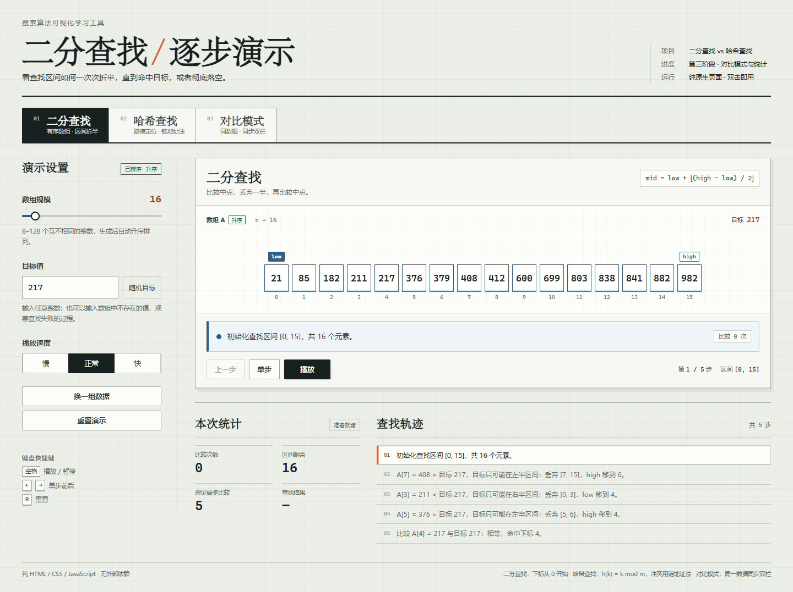
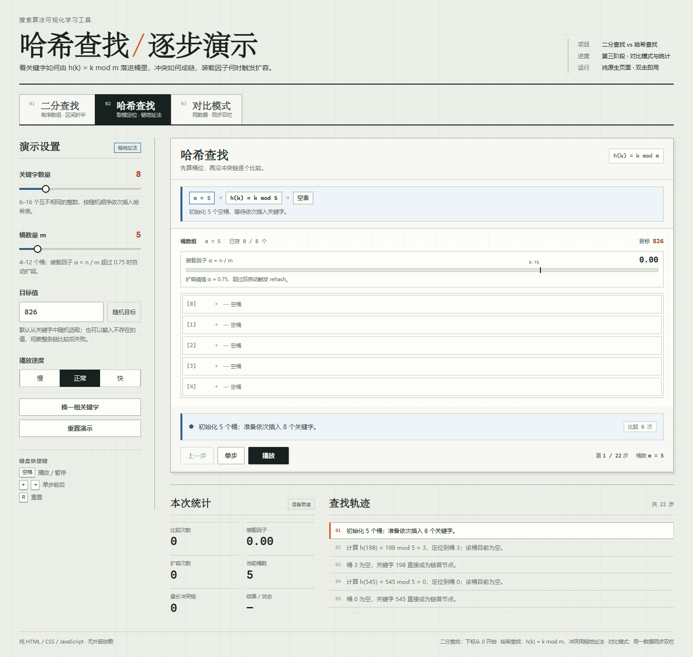
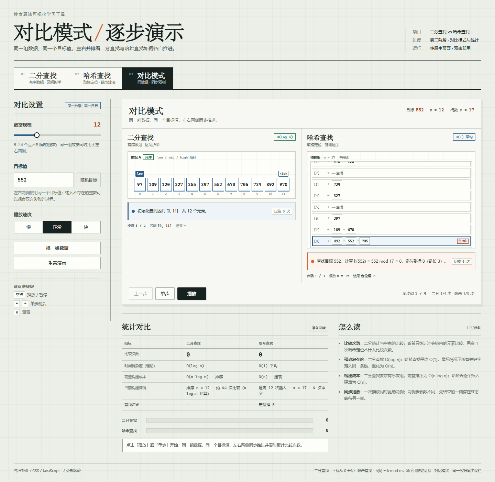

# ARIA 属性验证记录（Issue #12）

- 基线版本：`origin/main` @ `09ddc2a`（截图见 `aria-before/`）
- 改动版本：`agent/aria-tab-accessibility-3febfea78b3b`（截图见 `aria-after/`）
- 环境：Microsoft Edge + Playwright 1.65，视口 1440×1000，浅色主题，整页截图；
  通过注入固定的 `Math.random` 种子（`0x5eed1234`）让前后两次加载得到相同的数组、目标值与步骤；
  截图时关闭 CSS 动画与光标闪烁，保证对比只反映 DOM / ARIA 变化。

## 验证方式

1. **检查 ARIA 结构**：在浏览器 DevTools 的 Elements / Accessibility 面板查看
   `tablist`、`tab`、`tabpanel` 的 role、name、`aria-selected`、`aria-controls`，
   以及播放控制按钮的 `aria-label`。
2. **检查切换后状态**：点击标签页，或聚焦标签后按 `←` / `→` / `Home` / `End`，
   确认 `aria-selected`、`tabindex`、面板 `hidden` 与 `document.body[data-active-view]` 同步更新。
3. **检查键盘 Tab 顺序**：聚焦当前标签后按 `Tab` 进入可见面板，按 `Shift+Tab` 回到标签；
   连续按 `Tab` 时不会落入隐藏面板和未选中的标签（roving tabindex 模式）。
4. **检查播放状态**：播放、暂停、走到最后一步时，按钮可见文字与 `aria-label` 一起变化。
5. **确认无视觉回归**：用 Pillow 对前后截图做逐像素比较，三个视图的差异像素数均为 0。

## 结构验证结果

| 检查项 | 结果 |
| --- | --- |
| 标签容器 | `role="tablist"`，`aria-label="演示模块"` |
| 三个标签 | `role="tab"`；选中项 `aria-selected="true"` 且 `tabindex="0"`，其余为 `false` / `-1` |
| `aria-controls` | 分别指向 `view-binary` / `view-hash` / `view-compare`，目标元素均存在 |
| 三个面板 | `role="tabpanel"`，`aria-labelledby` 指向对应标签；非当前面板带 `hidden` |
| 切换后 | `aria-selected`、`tabindex`、面板可见性、`data-active-view` 一致更新 |

> 标签页的 role / `aria-selected` / `aria-controls` / `tabpanel` 与方向键切换在基线提交中已经存在。
> 本次未改动其行为，只补充按钮 `aria-label`，并用上述检查确认标签页语义和切换状态仍然正确。

## 播放控制 `aria-label`

| 视图 | 控件 | `aria-label` |
| --- | --- | --- |
| 二分查找 | 上一步 | 上一步：回看上一个查找步骤 |
| 二分查找 | 单步 | 单步：执行下一个查找步骤 |
| 二分查找 | 播放 / 暂停 / 重播 | 播放自动演示 / 暂停自动演示 / 重新播放演示 |
| 二分查找 | 重置 | 重置二分查找演示到第一步 |
| 二分查找 | 换一组数据 | 换一组数据：重新生成随机有序数组 |
| 二分查找 | 随机目标 | 随机生成目标值 |
| 哈希查找 | 上一步 / 单步 / 播放 | 上一步：回看上一个演示步骤 / 单步：执行下一个演示步骤 / 播放自动演示 |
| 哈希查找 | 重置 | 重置哈希查找演示到第一步 |
| 哈希查找 | 换一组关键字 | 换一组关键字：重新生成随机哈希数据 |
| 对比模式 | 上一步 / 单步 / 播放 | 上一步：回看上一个同步帧 / 单步：执行下一个同步帧 / 播放自动演示 |
| 对比模式 | 重置 | 重置对比演示到第一帧 |
| 对比模式 | 换一组数据 | 换一组数据：重新生成对比模式的随机数据 |

播放按钮的 `aria-label` 在 `render()` 中随状态更新，与可见文字 `播放` / `暂停` / `重播` 保持一致；
`aria-pressed` 维持原有行为。

## 键盘 Tab 顺序（二分查找视图，从标签标签开始）

| 顺序 | 焦点元素 |
| --- | --- |
| 1 | `#size`（数组规模） |
| 2 | `#target`（目标值） |
| 3 | `#random-target`（随机目标） |
| 4–6 | 慢 / 正常 / 快三个速度按钮 |
| 7 | `#regenerate`（换一组数据） |
| 8 | `#reset`（重置演示） |

未选中的 `#tab-hash`、`#tab-compare` 带 `tabindex="-1"`，不会出现在 Tab 序列中；
标签之间使用 `←` / `→` / `Home` / `End` 切换，切换后焦点跟随新标签。
哈希查找与对比模式的结果相同：`Tab` 分别进入 `#hash-size` / `#compare-size`，
`Shift+Tab` 回到当前标签。

## 视觉对比（同一随机种子、同一状态、同一视口）

| 视图 | Before（`09ddc2a`） | After（本分支） |
| --- | --- | --- |
| 二分查找 |  |  |
| 哈希查找 |  |  |
| 对比模式 |  |  |

逐像素比较结果：二分查找 0 个差异像素，哈希查找 0 个，对比模式 0 个；三张截图尺寸分别为
1440×1077、1440×1367、1440×1402。ARIA 属性只改变辅助技术的语义树，不改变视觉样式。
